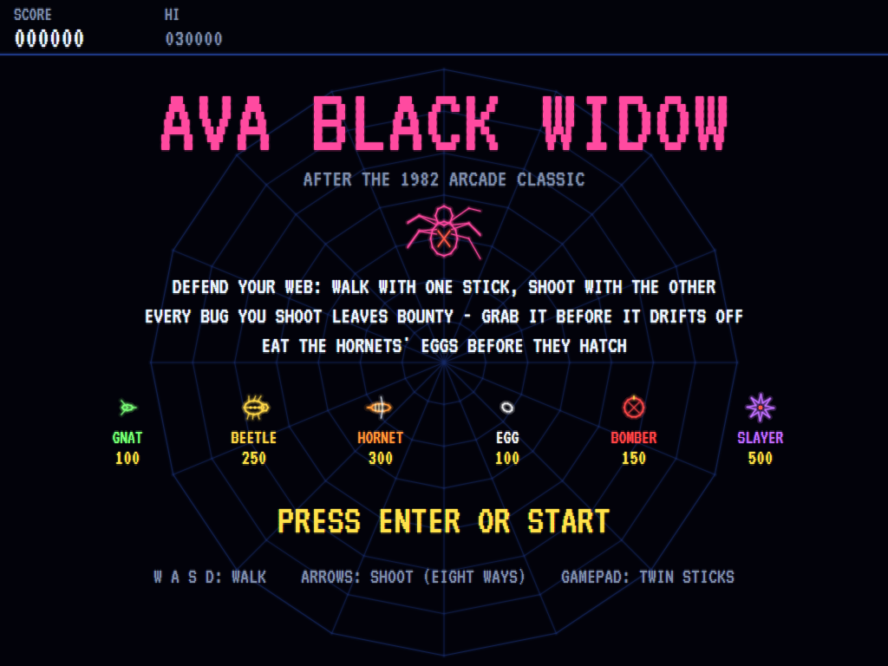
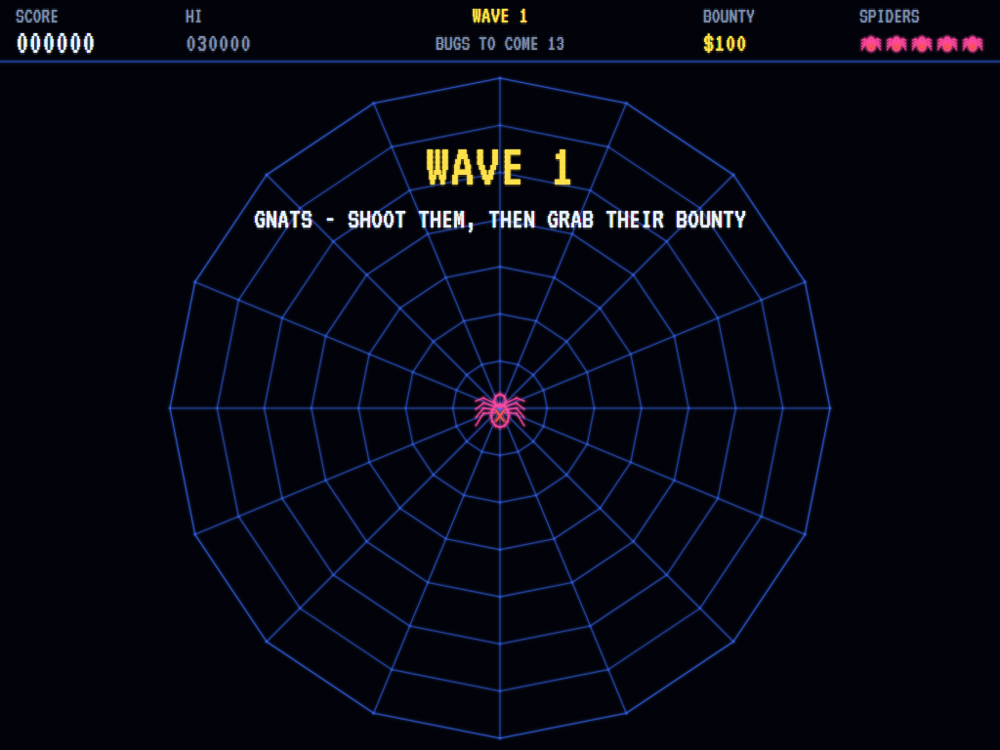
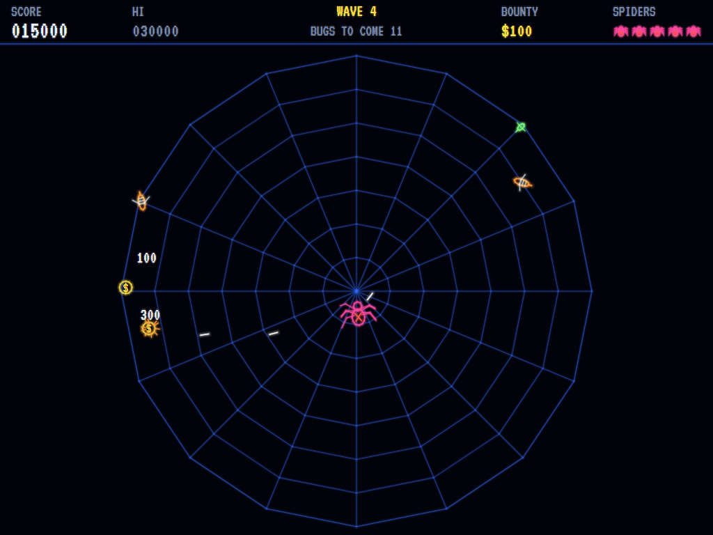
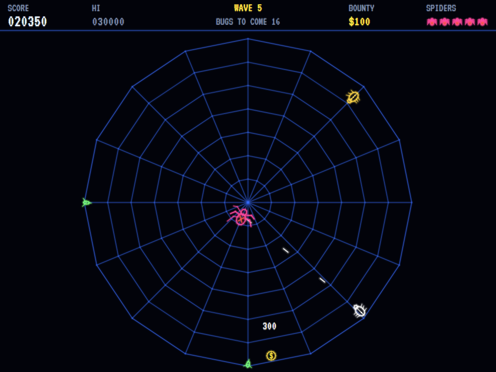
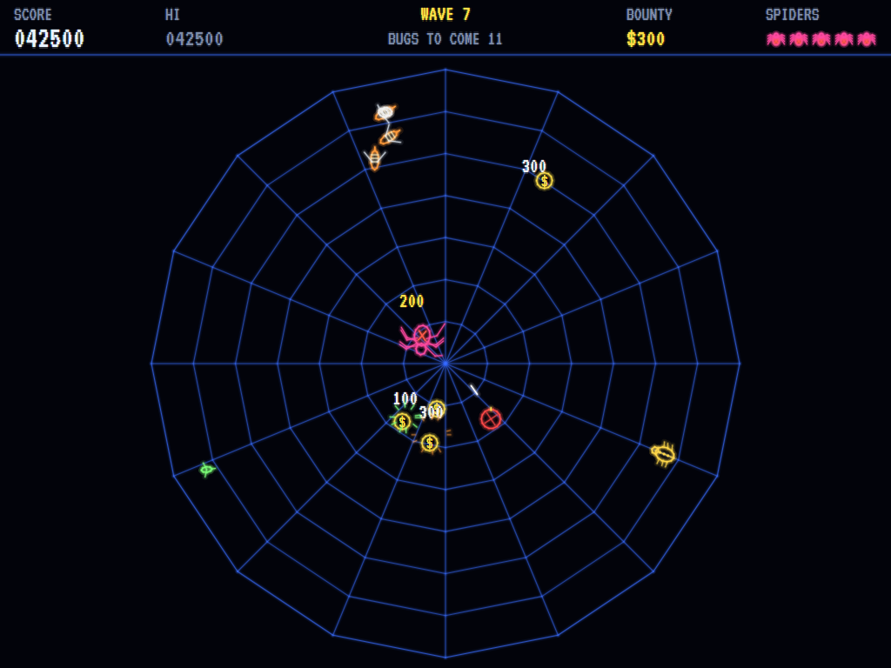
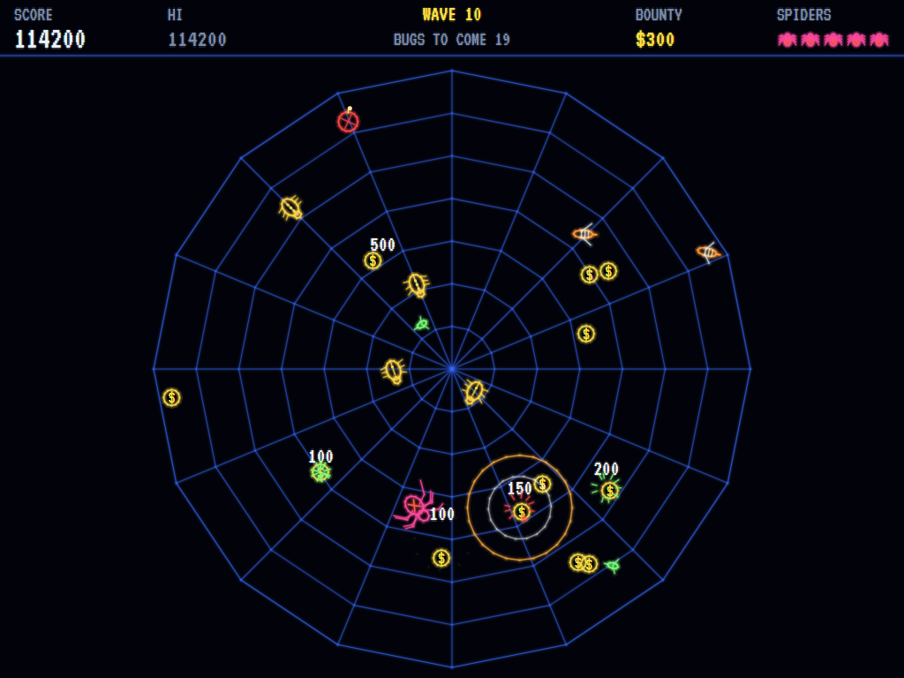
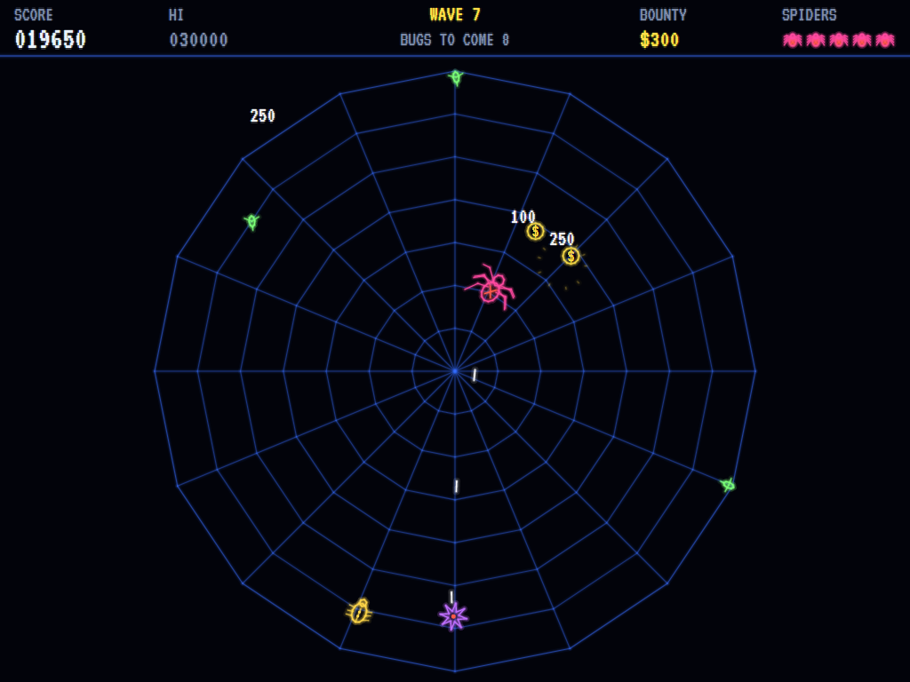
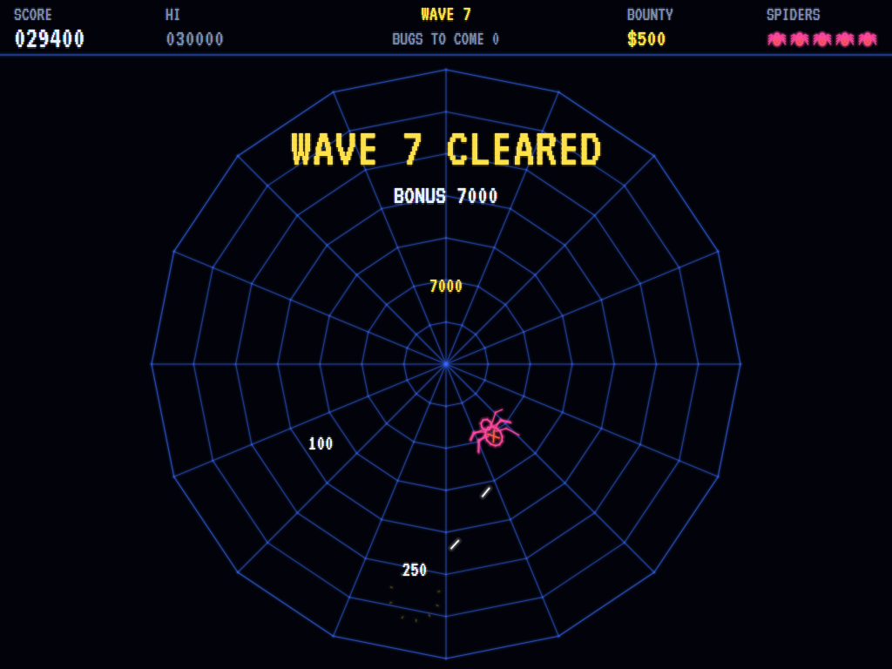
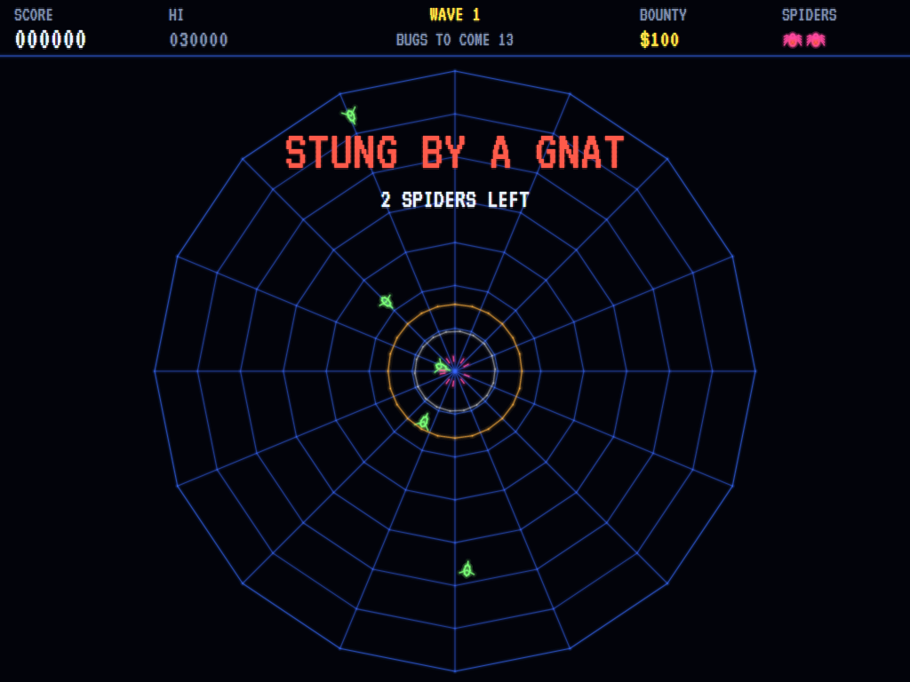
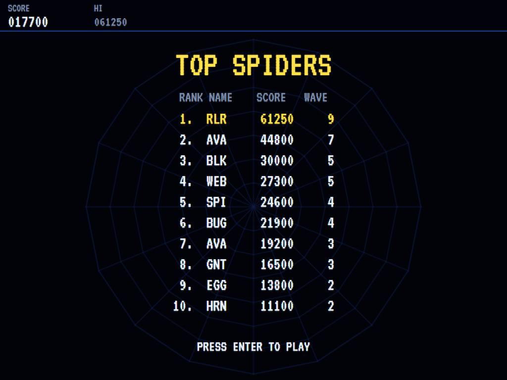

# AVA Black Widow

[](https://github.com/Harlock123/AVABlackWidow/actions/workflows/build.yml)

A twin-stick shooter in glowing vector lines, in the style of Atari's 1982 arcade game **Black
Widow**, built with .NET 10 and Avalonia UI. You are the spider at the heart of a web that bugs keep
crawling onto. Walk with one stick and shoot with the other. Every bug you shoot leaves a bounty coin
that drifts out towards the edge, and the more of them you grab in a row, the more each is worth.

## Features

- **Twin-stick control**: walk anywhere on the web with one stick, and shoot in any direction with the other. On the keyboard: W A S D to walk, the arrow keys (or the numeric keypad) to shoot eight ways.
- **The bugs**, one new kind every wave for the first five:
  - **Gnats** mill about and now and then dart straight at you.
  - **Beetles** crawl in along the spokes to the hub, then come for you. Each takes three hits, and every hit knocks it back.
  - **Hornets** swoop round you, dive, and lay eggs on the web.
  - **Eggs** hatch into gnats if you leave them. Shoot one or, better, walk over it and eat it.
  - **Bombers:** shoot one in a crowd and it blows up every bug near it, at double their points.
  - **Slayers** hunt you down and take three hits. One always comes out if a wave drags on.
- **Bounty**: every bug you kill drops a coin.
  - **The run:** the first coin is worth 100, each one after it 100 more, up to 1,500.
  - **Losing it:** coins drift out and are lost at the edge, and being caught starts the run again.
- **Waves**: every wave brings more bugs, sooner, faster and more of them at once, sometimes two at a time from opposite sides. Clearing one pays 1,000 times its number.
- **Scoring**:
  - Gnats 100, beetles 250, hornets 300, bombers 150, slayers 500, eggs 50 shot or 100 eaten
  - Double for anything caught in a bomber's blast
  - An extra spider at 20,000 points and every 40,000 after that
- **Vector graphics**: every line glows like a beam on a vector monitor. The spider's eight legs step as it walks, beetles show the hits they can still take, eggs wobble as they ripen, and bombers' fuses fizz.
- **Sound**: a creeping bass line under the play, with shots, hits, blasts, the coin chime, eggs laid and hatching, and the slayer's arrival. All of it is synthesised and mixed by OpenAL.
- **Attract mode**: leave the title alone for 15 seconds and a computer spider plays. It backs away from what comes close (the slayer most of all), grabs coins and eats eggs when the coast is clear, and leads its shots.
- **A top-ten high-score table** with arcade-style initials entry. It records the wave reached.
- **Gamepads** through SDL2: two sticks, with the face buttons as a four-way fallback for shooting.
- **Any window size**: the screen scales to fit, letterboxed. **Ctrl+S** saves a screenshot.
- **One self-contained executable** per platform: Windows, macOS and Linux on Intel/AMD and ARM.

## Screenshots

| The title | Wave one | Gnats and bounty |
|:---------:|:--------:|:----------------:|
|  |  |  |
| What every bug is worth. | The spider at the hub. | Shoot, then grab the coins. |

| Beetles | Hornets and eggs | A bomber goes up |
|:-------:|:----------------:|:----------------:|
|  |  |  |
| Three hits each. | Eat the eggs before they hatch. | And takes its neighbours with it. |

| The slayer | Wave cleared | Caught |
|:----------:|:------------:|:------:|
|  |  |  |
| It hunts you. | The bonus. | Standing still doesn't work. |

| The best spiders | | |
|:----------------:|:-:|:-:|
|  | | |
| The high-score table. | | |

The screenshots are made by the tests, which play the game in a real (headless) window; see
[Tests](#tests).

## Download and run

Ready-to-run builds for Windows, macOS and Linux, on both Intel/AMD and ARM, are on the
[Releases page](https://github.com/Harlock123/AVABlackWidow/releases/tag/latest). **Latest build** is
rebuilt on every push to `main`. Each download is one self-contained executable: no .NET install is
needed.

| Platform | Archive |
|---|---|
| Windows | `AVABlackWidow-win-x64.zip`, `AVABlackWidow-win-x86.zip`, `AVABlackWidow-win-arm64.zip` |
| macOS | `AVABlackWidow-osx-arm64.tar.gz` (Apple silicon), `AVABlackWidow-osx-x64.tar.gz` (Intel) |
| Linux | `AVABlackWidow-linux-x64.tar.gz`, `AVABlackWidow-linux-arm64.tar.gz`, `AVABlackWidow-linux-arm.tar.gz` |

```bash
tar -xzf AVABlackWidow-linux-x64.tar.gz     # or linux-arm64, linux-arm, osx-arm64, osx-x64
./AVABlackWidow
```

On Windows, unzip and run `AVABlackWidow.exe`. On macOS, if Gatekeeper refuses to open it, run
`xattr -d com.apple.quarantine AVABlackWidow` once. Run with `--no-audio` for silence.

**Sound** comes through OpenAL Soft, built in for every platform. In a virtual machine the game
detects it and uses a larger audio buffer, so the sound doesn't break up.

**Gamepads** use SDL2, which is bundled for Windows, macOS and Intel/AMD Linux. ARM Linux builds need it
installed; without it the keyboard still works:

```bash
sudo apt install libsdl2-dev            # Debian / Ubuntu / Raspberry Pi OS
sudo pacman -S --needed sdl2-compat     # Arch / Omarchy
```

## Controls

| Input | Action |
|-------|--------|
| **Enter** / **Space** | Start |
| **W** / **A** / **S** / **D** | Walk (diagonals too) |
| **Arrow keys** (two at once for diagonals) or the **numeric keypad** | Shoot eight ways |
| **P** / **Esc** | Pause (Esc again to quit) |
| **M** | Mute |
| **Ctrl+S** / **Cmd+S** | Save a screenshot to the Pictures folder |

**Gamepad**: the left stick or D-pad walks and the right stick shoots in any direction. **Y**, **A**,
**X** and **B** shoot up, down, left and right. **Start** starts and pauses, **Back** (while paused)
quits.

**Entering initials**: type letters, or dial with **Up**/**Down** and accept with **Space**; **Left** /
**Backspace** go back; **Enter** finishes.

## Tests

```bash
dotnet test AVABlackWidow.slnx
```

The engine has no UI and runs in fixed 60 Hz steps, so it plays the same at any frame rate, and a seed
always plays the same game. The tests check, mostly with bugs placed where the test wants them:

- **The spider:** walking any way but never off the web, and shooting where the other stick points, a few shots at a time
- **The bugs:**
  - a shot gnat scoring and leaving a coin that drifts out and is lost
  - coins in a row rising in value to the cap, and starting again when the spider is caught
  - beetles taking three knock-back hits, crawling to the hub and then coming for the spider
  - hornets laying eggs, eggs shot, eaten or hatching into gnats
  - a bomber's blast taking its neighbours for double points
  - the slayer hunting the spider down, and coming out when a wave drags on
- **Waves and spiders:**
  - each wave's new kind of bug, the wave bonus and the next wave
  - a caught spider coming back with the bugs near the middle swept away to return later
  - the last spider ending the game, and the extra spider
- **The machine:** the computer spider clearing the first waves, the attract cycle, the same game from the same seed, initials and the high-score file

The screenshot tests draw the real screen in a headless window. To refresh the README's pictures:

```bash
WIDOW_SHOTS=$PWD/Images dotnet test tests/AVABlackWidow.Tests --filter ScreenshotTests
```

To see how the computer spider gets on, aiming eight ways like a keyboard player (or `WIDOW_PROBE=still`
for one that never moves):

```bash
WIDOW_PROBE=1 dotnet test tests/AVABlackWidow.Tests --filter PilotProbe --logger "console;verbosity=detailed"
```

## Building

```bash
dotnet build AVABlackWidow.slnx
dotnet run --project src/AVABlackWidow
```

Needs the .NET 10 SDK. The sounds are made by `tools/make_sounds.py` (standard-library Python):
`python3 tools/make_sounds.py` rewrites `src/AVABlackWidow/Sounds`.

## Project structure

```
AVABlackWidow/
├── AVABlackWidow.slnx
├── src/AVABlackWidow/
│   ├── Engine/
│   │   ├── GameEngine.cs        # States, the title and demo cycle, and the music
│   │   ├── GameEngine.Play.cs   # Walking and shooting, the six kinds of bug, eggs, the bomber's blast,
│   │   │                        # bounty coins, waves, scoring and spiders
│   │   ├── SpiderPilot.cs       # The computer spider, for the demonstration (and the tests)
│   │   ├── Entities.cs
│   │   ├── HighScoreTable.cs, InitialsEntry.cs
│   │   ├── InputHandler.cs, ControllerManager.cs  # Twin-stick keys and an SDL2 gamepad
│   │   └── SoundManager.cs      # Effects, the music and the tunes through OpenAL
│   ├── Audio/                   # The OpenAL engine (from the author's AVABand)
│   ├── Views/                   # The vector-beam web, spider and bugs, the score bar and the screens
│   └── Sounds/                  # The synthesised effects and tunes
├── tests/AVABlackWidow.Tests/   # Gameplay, screenshot and probe tests
├── tools/make_sounds.py
└── Images/                      # Screenshots
```

## About and licence

AVA Black Widow © 2026 Lonnie Watson, under the [MIT License](LICENSE).

*Black Widow* © 1982 Atari; the name belongs to its current owner. AVA Black Widow is an independent,
unofficial game in its style. Its bugs, bounty, graphics, sounds, tunes and code are its own; nothing is
taken from the arcade machine's program, graphics or sound. It is not affiliated with or endorsed by any
rights holder.
